# 🪙 ChainChit

> **Reverse Auction Bidding Engine & Statistical Bid-Fraud Detection System for Chit Funds**  
> *Coursework Project implementing core algorithmic bidding, Gaussian Z-score anomaly detection, and tamper-evident SHA-256 cryptographic audit logs.*

---

## 📋 Table of Contents
- [Overview](#-overview)
- [Key Features](#-key-features)
  - [1. Reverse Auction Bidding Engine](#1-reverse-auction-bidding-engine)
  - [2. Real-Time Statistical Fraud Detection](#2-real-time-statistical-fraud-detection)
  - [3. Foreman Command Center & Cycle Supervision](#3-foreman-command-center--cycle-supervision)
  - [4. Multi-Cycle Simultaneous Sessions](#4-multi-cycle-simultaneous-sessions)
  - [5. Tamper-Evident Cryptographic Audit Trail](#5-tamper-evident-cryptographic-audit-trail)
  - [6. Real KYC & Role-Based Access Control (RBAC)](#6-real-kyc--role-based-access-control-rbac)
- [Tech Stack](#-tech-stack)
- [Database Architecture](#-database-architecture)
- [Installation & Local Setup](#-installation--local-setup)
  - [Prerequisites](#prerequisites)
  - [Step-by-Step Setup](#step-by-step-setup)
- [Default System Credentials](#-default-system-credentials)
- [Walkthrough & Verification Flow](#-walkthrough--verification-flow)
- [Running Automated Tests](#-running-automated-tests)
- [Project Structure](#-project-structure)

---

## 🌟 Overview

Traditional Chit Funds (ROSCA - Rotating Savings and Credit Associations) frequently suffer from opaque bid management, foreman favoritism, collusive underbidding, and lack of verifiable audit trails. 

**ChainChit** replaces the manual auctioneer with an automated, transparent full-stack engine:
- **Reverse Auction Mechanism**: Members bid the lowest prize payout they are willing to accept from the chit pool. The lowest valid bidder claims the payout, while the remainder is redistributed as dividends among other members.
- **Statistical Fraud Detection**: Every bid is mathematically evaluated against historical group distributions. Unrealistic deep underbids or collusive patterns are flagged in real-time, holding payout escrow for administrative review.
- **Tamper-Evident Audit Chain**: Every state transition, bid placement, fraud alert, and foreman decision is cryptographically chained using SHA-256 hashes, providing mathematical proof against log tampering.

---

## 🚀 Key Features

### 1. Reverse Auction Bidding Engine
- **Countdown Auction Window**: Configurable bidding duration (default 180s) with live real-time synchronization.
- **Dynamic Bid Processing**: Submissions are validated against pool value, member enrollment, and KYC verification status.
- **Self-Outbid Prevention**: If a member currently holds the lowest valid accepted bid, they are currently winning and cannot submit another bid against themselves until an outbid occurs.
- **Automated Winner Determination**: Upon timer expiration, the engine identifies the lowest valid bid (disregarding flagged fraudulent bids) and locks the payout in escrow.

### 2. Real-Time Statistical Fraud Detection
- **Gaussian Bell Curve Modeling**: Dynamically calculates the chit group's historical mean ($\mu$) and standard deviation ($\sigma$).
- **Z-Score Anomaly Detection ($Z > 2.5$)**:
  $$\text{Z-Score} = \frac{\mu - \text{Bid Amount}}{\sigma}$$
  Deep underbids that deviate beyond 2.5 standard deviations are flagged as `FLAGGED_SUSPICIOUS` and quarantined from winning.
- **Collusion Frequency Checks**: Flags accounts exhibiting repetitive rapid-fire bidding or collusive bid suppression patterns.
- **Quarantined Escrow**: If a flagged bid would have won or disrupted the auction, payout escrow transitions to `HELD_FOR_REVIEW` pending Foreman triage.

### 3. Foreman Command Center & Cycle Supervision
- **Live Active Sessions Monitor**: Track active bidding rooms across all registered chit fund groups simultaneously.
- **Real-Time Timer Controls**: Extend ongoing countdown timers on-the-fly (`+60s`, `+120s`). Emits Server-Sent Events (SSE) to update all connected member countdowns instantly.
- **Emergency Halt / Force Stop**: Stop any active cycle immediately. The engine resolves the lowest legitimate bid, finalizes the winner, and writes an audit record.
- **Member KYC Approvals**: Review government identities (Aadhaar/PAN) of newly registered members and approve or reject them with mandatory recorded reasons.
- **Chit Group Creation**: Configure custom chit pool amounts, duration, member capacities, and enroll KYC-verified participants.

### 4. Multi-Cycle Simultaneous Sessions
- **Live Navbar Indicator**: Displays active cycle count (e.g., `(2 Live)`) in the navigation bar from any screen.
- **Interactive Multi-Room Switcher**: When multiple groups are bidding simultaneously, a top-level room switcher on the home page allows seamless switching between rooms.
- **Dedicated Route per Room (`/cycle/[id]`)**: Each cycle has an isolated dynamic URL with its own dedicated SSE event stream, live bid feed, and statistical bell curve.
- **Cycle History & Archives**: Completed, settled, and disputed sessions are archived with full payout and winner recaps.

### 5. Tamper-Evident Cryptographic Audit Trail
- **SHA-256 Hash Chaining**: Every log entry contains the cryptographic hash of the previous block:
  $$\text{Current Hash} = \text{SHA-256}(\text{Index} + \text{Timestamp} + \text{Action} + \text{ActorId} + \text{PrevHash} + \text{Payload})$$
- **Cryptographic Verification**: Built-in verification algorithm verifies chain continuity and flags any modified, inserted, or deleted logs.
- **Exportable Records**: Auditors and overseers can export the complete tamper-evident audit ledger to CSV.

### 6. Real KYC & Role-Based Access Control (RBAC)
- **Zero Dummy Data Policy**: Only one pre-seeded administrative Foreman account exists in the database. All members register dynamically with real credentials.
- **Strict Route Protection**: Middleware and API routes strictly enforce role permissions:
  - `MEMBER`: Access bidding rooms, place bids, view status.
  - `FOREMAN`: Access Foreman Controls (`/foreman`), manage groups, approve KYC, triage fraud alerts, supervise cycles.
  - `OVERSIGHT_VIEWER`: Access read-only Audit Log (`/audit`) and verify cryptographic hashes.

---

## 🛠 Tech Stack

| Layer | Technology | Purpose |
|:---|:---|:---|
| **Framework** | [Next.js](https://nextjs.org/) (App Router, Webpack) | Full-stack React framework with server and client components |
| **Language** | [TypeScript](https://www.typescriptlang.org/) | Type-safe development across frontend and backend |
| **Database** | [PostgreSQL](https://www.postgresql.org/) | Relational database for transactions, users, bids, and audit logs |
| **ORM** | [Drizzle ORM](https://orm.drizzle.team/) | Type-safe SQL query builder and schema management |
| **Styling** | [Tailwind CSS](https://tailwindcss.com/) | Dark-mode, responsive UI design |
| **Real-Time** | Server-Sent Events (SSE) | Real-time push for new bids, fraud alerts, and timer updates |
| **Security** | Web Crypto / Node `crypto` | `scrypt` password hashing and SHA-256 audit chaining |
| **Icons** | [Lucide React](https://lucide.dev/) | Clean, accessible system icons |

---

## 🗄 Database Architecture

```mermaid
erDiagram
    users ||--o{ group_members : participates
    users ||--o{ bids : places
    users ||--o{ cycles : wins
    chit_groups ||--o{ group_members : enrolls
    chit_groups ||--o{ cycles : schedules
    cycles ||--o{ bids : receives
    cycles ||--o{ fraud_alerts : generates
    bids ||--o{ fraud_alerts : flags
    users ||--o{ audit_logs : triggers

    users {
        uuid id PK
        string name
        string email UK
        string passwordHash
        string mobile
        string govtId
        enum role "MEMBER | FOREMAN | OVERSIGHT_VIEWER"
        enum kycStatus "PENDING | VERIFIED | REJECTED"
        int trustScore
    }

    chit_groups {
        uuid id PK
        string name
        int chitValue
        int numberOfMembers
        int historicalMeanBid
        int historicalSdBid
        float fraudThresholdZ
    }

    cycles {
        uuid id PK
        uuid groupId FK
        int cycleNumber
        enum status "SCHEDULED | BIDDING_OPEN | BIDDING_CLOSED | SETTLED | DISPUTED"
        timestamp biddingEndTime
        int biddingDurationSeconds
        int payoutAmount
        enum escrowStatus "LOCKED | RELEASED | HELD_FOR_REVIEW"
        uuid winnerMemberId FK
    }

    bids {
        uuid id PK
        uuid cycleId FK
        uuid memberId FK
        int bidAmount
        enum status "ACCEPTED | FLAGGED_SUSPICIOUS | DISQUALIFIED | WINNING_BID"
        float zScore
        boolean isAnomaly
    }

    audit_logs {
        uuid id PK
        int sequenceNumber
        string action
        uuid actorId
        string previousHash
        string currentHash
        jsonb payload
    }
```



---

## 💻 Installation & Local Setup

### Prerequisites
- **Node.js**: v18.17.0 or higher
- **PostgreSQL**: v14 or higher (running locally on port `5432`)
- **npm** or **pnpm**

### Step-by-Step Setup

1. **Clone the Repository**:
   ```bash
   git clone git@github-personal:vim-all/chainchit.git
   cd chainchit
   ```

2. **Install Dependencies**:
   ```bash
   npm install
   ```

3. **Configure Environment Variables**:
   Create a `.env.local` file in the root directory:
   ```env
   DATABASE_URL="postgres://localhost:5432/chainchit"
   PORT=3000
   ```
   *(Ensure a PostgreSQL database named `chainchit` exists: `createdb chainchit`)*

4. **Initialize Database Schema**:
   Push the Drizzle ORM schema to PostgreSQL:
   ```bash
   npx drizzle-kit push
   ```

5. **Seed the Genesis Foreman & Audit Root**:
   ```bash
   npm run seed
   ```

6. **Start the Development Server**:
   ```bash
   npm run dev
   ```
   Open [http://localhost:3000](http://localhost:3000) in your browser.

---

## 🔑 Default System Credentials

To maintain strict data integrity, the system seeds **only one pre-configured administrative account**:

| Role | Email | Password | Access Rights |
|:---|:---|:---|:---|
| **Foreman** | `foreman@chainchit.io` | `Password@123` | Full administrative controls: KYC approvals, group creation, cycle launch/stop/edit, fraud alert triage |

> **Note**: Real members do not have pre-seeded accounts. Members register via the [`/register`](http://localhost:3000/register) page and are approved by the Foreman.

---

## 🧪 Walkthrough & Verification Flow

### 1. Log in as Foreman
1. Open [http://localhost:3000/login](http://localhost:3000/login).
2. Click **Auto-Fill Foreman Account** (or type `foreman@chainchit.io` / `Password@123`).
3. You will be authenticated into the **Foreman Command Center** (`/foreman`).

### 2. Register Real Members (Incognito Window)
1. Open an Incognito window and navigate to [http://localhost:3000/register](http://localhost:3000/register).
2. Register a new user:
   - **Name**: `Raj Kumar`
   - **Email**: `raj@chainchit.io`
   - **Password**: `Password@123`
   - **Mobile**: `9876543210`
   - **Govt ID (PAN/Aadhaar)**: `ABCDE1234F`
3. Notice Raj's account has status **KYC Pending**.

### 3. Approve KYC
1. In the Foreman window, navigate to the **Member KYC Approvals** tab.
2. Click **Approve KYC** next to Raj Kumar.

### 4. Create Group & Launch Bidding Cycle
1. Go to **Create Chit Group**:
   - Pool Value: `₹1,00,000`
   - Members: `5`
   - Enroll `Raj Kumar`.
2. Go to **Launch & Supervise Cycles**:
   - Set Timer: `180` seconds.
   - Click **Open Bidding Window**.

### 5. Place Bids & Verify Self-Outbid Rule
1. In Raj Kumar's window, navigate to [http://localhost:3000](http://localhost:3000).
2. Raj enters the live bidding room.
3. Submit a bid of `₹92,000`. The bid is accepted.
4. Attempt to submit another bid as Raj:
   - The bid button automatically disables with the notice:
     *"You currently hold the lowest valid bid (₹92,000). You cannot bid against yourself until another member places a lower bid."*

### 6. Test Foreman Timer Extension & Stop
1. In the Foreman window under **Launch & Supervise Cycles**, locate the active session.
2. Click **+60s**: Observe the timer increase by 60 seconds on both Foreman and Member screens in real-time.
3. Click **Stop Bidding Window**: The cycle concludes immediately, declaring Raj Kumar the winner.

### 7. Inspect Cryptographic Audit Log
1. Navigate to [http://localhost:3000/audit](http://localhost:3000/audit).
2. Verify all actions (`BID_SUBMITTED`, `CYCLE_TIMER_EXTENDED`, `CYCLE_FORCE_STOPPED`, `CYCLE_SETTLED`).
3. Click **Verify Audit Integrity**: Confirms that SHA-256 hash chains match mathematically.

---

## 🧪 Running Automated Tests

Run the mathematical fraud detection and SHA-256 audit chaining test suite:

```bash
npm test
```

Expected output:
```
▶ Statistical Bid-Fraud Detection Mathematical Engine
  ✔ FT-13: Normal competitive bid within window is accepted
  ✔ FT-15: Abnormal deep underbid (₹60,000) is flagged as suspicious
  ✔ FT-16: Winner selection correctly identifies lowest VALID bid
✔ Statistical Bid-Fraud Detection Mathematical Engine
▶ Tamper-Evident SHA-256 Audit Log Hash Chaining (NFR13)
  ✔ detects tampering when payload or previous hash is modified
✔ Tamper-Evident SHA-256 Audit Log Hash Chaining (NFR13)
ℹ pass 4
ℹ fail 0
```

To verify production bundle compilation:
```bash
npm run build -- --webpack
```

---

## 📁 Project Structure

```
chainchit/
├── app/
│   ├── (auth)/
│   │   ├── login/page.tsx           # Authentication login
│   │   └── register/page.tsx        # Member registration & KYC submission
│   ├── api/
│   │   ├── audit/                   # Audit log retrieval & verification
│   │   ├── auth/                    # Login, logout, session management
│   │   ├── cycles/                  # Bidding cycle queries, bids, settlement
│   │   ├── foreman/                 # Foreman KYC, group, & cycle supervision APIs
│   │   └── fraud/                   # Adjudication & override endpoints
│   ├── audit/page.tsx               # Cryptographic audit ledger UI
│   ├── cycle/[id]/page.tsx          # Dedicated room for individual cycles
│   ├── foreman/page.tsx             # Foreman command center
│   ├── layout.tsx                   # Root layout
│   └── page.tsx                     # Main Bidding Room & Multi-Room Switcher
├── components/
│   ├── bidding/                     # Countdown timer, bid form, live feed, modals
│   ├── fraud/                       # Gaussian distribution bell curve chart
│   └── navbar.tsx                   # Navigation with live active cycle counter
├── lib/
│   ├── audit-logger.ts              # SHA-256 cryptographic hash chaining
│   ├── auth.ts                      # Password hashing & session cookies
│   ├── fraud-detector.ts            # Statistical Z-score & collusion analysis
│   ├── sse-broker.ts                # Server-Sent Events broker
│   └── db/
│       ├── index.ts                 # PostgreSQL Drizzle client
│       ├── schema.ts                # Relational database schema
│       └── seed.ts                  # Genesis Foreman seed
├── middleware.ts                    # RBAC route protection
├── tests/
│   └── fraud-engine.test.ts         # Math engine & SHA-256 unit tests
└── README.md
```

---

## 📄 License
This project is developed for academic and coursework demonstration purposes under the MIT License.
